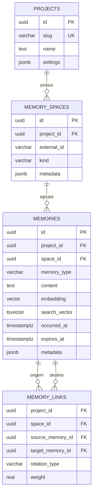

# extend-memory-ai

Serviço enxuto de memória de longo prazo para aplicações de IA, com PostgreSQL
como fonte de verdade.

## Objetivo

O serviço recebe memórias já extraídas pelas aplicações clientes, preserva o
contexto de origem e permite recuperá-las por texto, significado e período. Ele
é inspirado nos conceitos de `retain` e `recall` do
[Hindsight](https://hindsight.vectorize.io/), mas o primeiro corte não tenta
reproduzir consolidação automática, reflexão por LLM ou páginas de conhecimento.

As decisões deste repositório são descritas por critérios de aceitação em
Gherkin, no idioma português (`# language: pt`). A especificação inicial está em
[`features/estrutura_memoria.feature`](features/estrutura_memoria.feature).

## Escopo da primeira etapa

- isolar completamente os dados de cada projeto de IA;
- subdividir um projeto em espaços de memória, como um usuário ou agente;
- armazenar memórias atômicas, e não transcrições inteiras;
- recuperar por busca textual, vetorial e filtros temporais;
- manter origem, metadados, expiração e relações explícitas entre memórias;
- possibilitar repetição segura de uma escrita por chave de idempotência.

Ficam fora deste primeiro corte: extração de fatos com LLM, geração de
embeddings, reranking, consolidação de observações e particionamento físico por
projeto. A autenticação HTTP é definida na
[arquitetura da API](docs/arquitetura-api.md#autenticação-e-autorização).

## Modelo de dados



### `projects`

Representa o tenant: cada aplicação de IA tem um projeto. O `slug` é um nome
estável para APIs e o `id` UUID evita que identificadores sequenciais revelem
quantos projetos existem. `settings` guarda configuração pouco consultada sem
obrigar uma alteração de schema a cada nova opção.

O projeto é a fronteira de segurança. Todas as tabelas do domínio carregam
`project_id`, mesmo quando ele poderia ser inferido por um relacionamento. Essa
redundância é intencional: simplifica políticas de Row-Level Security (RLS),
índices e uma futura estratégia de particionamento.

### `memory_spaces`

É uma coleção isolada dentro do projeto, equivalente a um banco de memórias.
Pode representar um usuário, agente, equipe ou outra fronteira definida pelo
cliente. `external_id` permite usar o identificador do sistema de origem sem
acoplar a chave primária interna a ele, e é único somente dentro do projeto.

Separar espaço de projeto evita dois extremos: criar uma tabela para cada
cliente ou misturar todas as memórias de usuários diferentes em uma única
coleção lógica.

### `memories`

É a unidade atômica de conhecimento. Uma linha deve expressar um fato,
preferência, decisão, observação, resumo ou contexto que faça sentido quando
recuperado isoladamente.

- `content` é a representação legível e continua sendo a fonte de verdade;
- `embedding vector(1536)` oferece similaridade semântica por cosseno;
- `search_vector` é gerado pelo PostgreSQL com stemming em português e remoção
  de acentos, atendendo nomes e termos exatos que embeddings podem diluir;
- `occurred_at` descreve quando o fato aconteceu, enquanto `created_at`
  registra quando chegou ao serviço;
- `expires_at` dá suporte a memórias temporárias sem apagar seu histórico
  imediatamente;
- `source_type` e `source_ref` preservam rastreabilidade até a origem;
- `importance`, entre `0` e `1`, permite influenciar um ranking futuro;
- `idempotency_key` impede duplicação quando um cliente repete a mesma
  requisição;
- `metadata` recebe atributos específicos do cliente que não justificam colunas
  globais;
- `deleted_at` implementa exclusão lógica e permite auditoria ou recuperação.

A dimensão `1536` é uma decisão explícita da primeira versão. Todos os projetos
devem usar embeddings compatíveis; trocar de modelo por outro com dimensão
diferente exigirá uma migração ou uma tabela de embeddings separada.

### `memory_links`

Registra somente relações explícitas (`related_to`, `supports`, `contradicts`,
`supersedes` e `derived_from`). As chaves estrangeiras compostas impedem uma
relação entre projetos ou espaços diferentes. A tabela prepara navegação simples
por contexto relacionado sem introduzir um banco de grafos ou inferência
automática no MVP.

## Recuperação

A busca híbrida deverá executar, sempre dentro de um único `project_id` e
`space_id`:

1. busca lexical com Full Text Search;
2. busca semântica por distância de cosseno (`<=>`);
3. filtros de validade (`deleted_at IS NULL` e
   `expires_at IS NULL OR expires_at > now()`);
4. fusão das listas por posição, por exemplo Reciprocal Rank Fusion (RRF), em
   vez de somar scores que possuem escalas incompatíveis;
5. corte pelo orçamento de tokens da aplicação chamadora.

No início, a consulta vetorial pode ser exata. Um índice HNSW deve ser adicionado
quando volume e medições justificarem a troca de recall por velocidade. Em um
índice aproximado compartilhado, o filtro por tenant ocorre depois da varredura
e pode reduzir resultados; com muitos projetos, devem ser avaliados scans
iterativos, índices parciais ou particionamento. Consulte a documentação de
[filtros e multitenancy do pgvector](https://github.com/pgvector/pgvector#filtering).

## Isolamento entre projetos

O schema habilita e força RLS nas quatro tabelas. Antes de qualquer operação, a
aplicação deve abrir uma transação e definir o projeto corrente:

```sql
BEGIN;
SET LOCAL app.current_project_id = '00000000-0000-0000-0000-000000000000';
-- consultas e alterações do projeto
COMMIT;
```

`SET LOCAL` limita o contexto à transação e evita vazamento de tenant quando há
pool de conexões. Em produção, a aplicação deve conectar com um usuário sem
`SUPERUSER` e sem `BYPASSRLS`; o usuário `postgres` do ambiente local ignora RLS
e existe apenas para desenvolvimento.

RLS é defesa em profundidade. A API ainda deve autenticar a credencial, resolver
o projeto autorizado e nunca aceitar `project_id` arbitrário como identidade.

## Arquivos de banco

Os scripts em `database/initdb` são executados em ordem quando o volume do banco
é criado:

- `001-full-text-search.sql`: `unaccent`, `pg_trgm` e configuração de busca em
  português;
- `002-vector.sql`: extensão `vector` do pgvector;
- `003-memory-schema.sql`: tabelas, restrições, índices, gatilhos e políticas
  RLS.

Scripts de `docker-entrypoint-initdb.d` não são reaplicados em volumes já
existentes. Depois do protótipo, alterações de schema devem usar uma ferramenta
de migração versionada.

## Executar localmente

```bash
docker compose up -d
docker compose exec postgres psql -U postgres -d extend_memory_for_ai
```

As credenciais do `docker-compose.yaml` são deliberadamente locais e não devem
ser usadas em produção.

## API

A arquitetura da API HTTP (Go) que expõe `retain` e `recall` às aplicações
clientes está em [`docs/arquitetura-api.md`](docs/arquitetura-api.md). O
contrato público está em [`api/openapi.yaml`](api/openapi.yaml) e os critérios de
aceitação em [`features/api_memoria.feature`](features/api_memoria.feature).

O plano de implementação começa pela
[Etapa 1 — Fundação da API](docs/etapa-01-fundacao.md).

## Princípios para as próximas atividades

- cada mudança funcional começa com cenários Gherkin observáveis;
- dados de projetos diferentes nunca participam da mesma consulta ou relação;
- toda memória recuperada deve ser rastreável até sua origem;
- metadados flexíveis não substituem colunas para campos consultados com
  frequência;
- otimizações de índice são decididas por volume, latência e qualidade de
  recuperação medidos.
