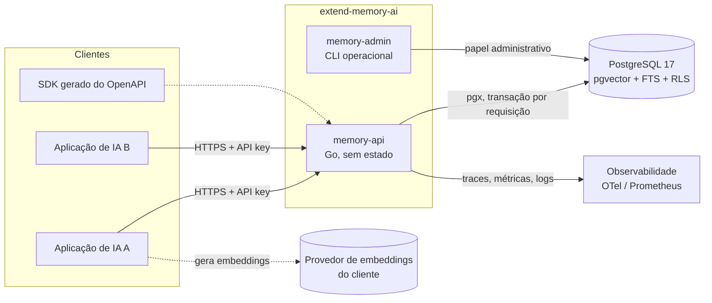
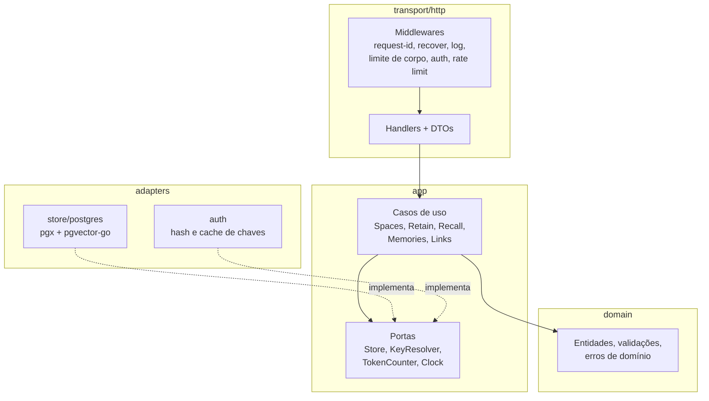
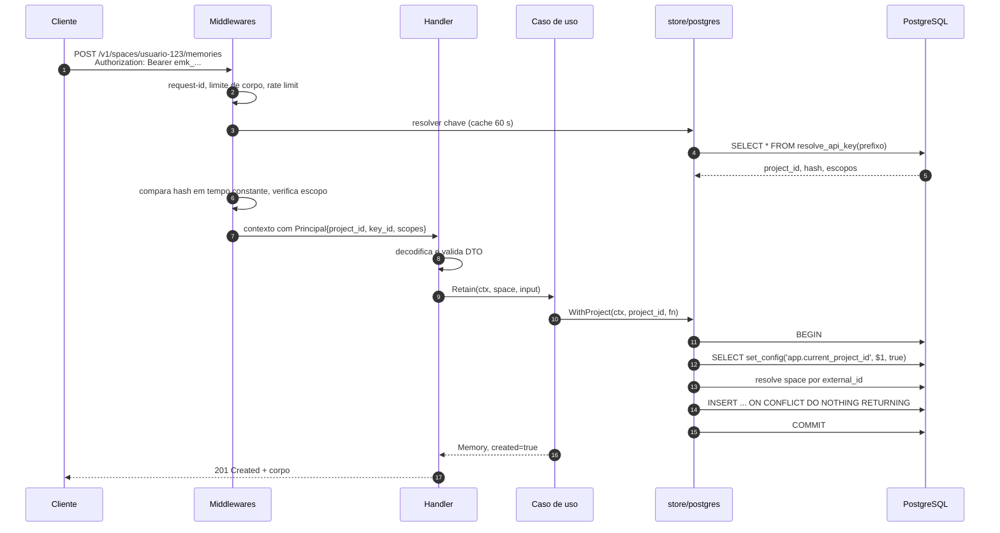
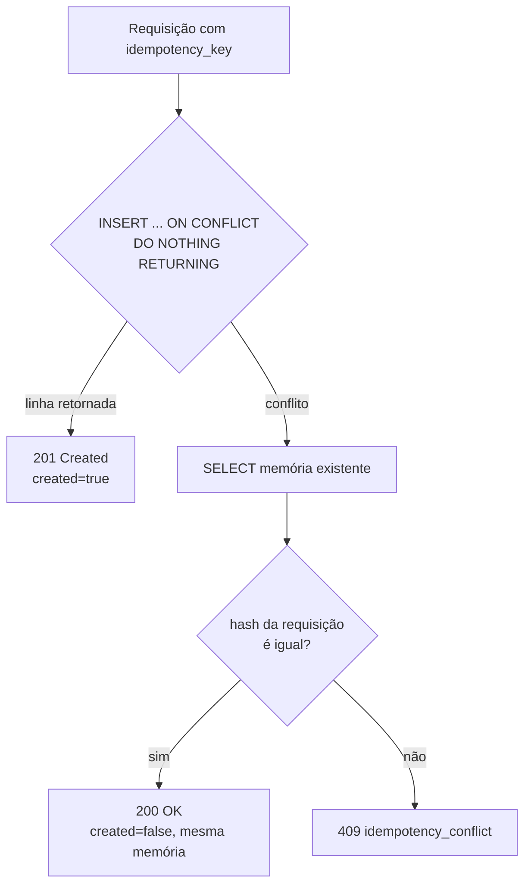
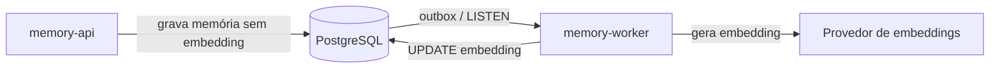

# Arquitetura da API de memória

Este documento define a arquitetura da API HTTP que expõe o serviço de memória
para as aplicações clientes. Ele parte do modelo de dados descrito no
[`README.md`](../README.md) e do schema em
[`database/initdb/003-memory-schema.sql`](../database/initdb/003-memory-schema.sql).
A implementação será em Go; este documento não contém código de aplicação, apenas
as decisões, contratos e fronteiras que a implementação deve seguir.

- Contrato HTTP: [`api/openapi.yaml`](../api/openapi.yaml) (OpenAPI 3.1).
- Critérios de aceitação: [`features/api_memoria.feature`](../features/api_memoria.feature).

## Objetivos e não objetivos

**Objetivos**

- oferecer às aplicações de IA duas operações centrais: `retain` (gravar
  memórias atômicas já extraídas) e `recall` (recuperar memórias relevantes por
  texto, significado e período);
- derivar o projeto (tenant) exclusivamente da credencial, nunca de um parâmetro
  enviado pelo cliente;
- manter o PostgreSQL como única fonte de verdade e o processo da API sem estado,
  para escalar horizontalmente;
- publicar um contrato estável e versionado, a partir do qual SDKs possam ser
  gerados.

**Não objetivos desta etapa** (coerentes com o escopo do README)

- extração de fatos com LLM, geração de embeddings e reranking: o cliente envia
  o embedding pronto, tanto ao gravar quanto ao pesquisar;
- consolidação automática ou reflexão;
- painel administrativo HTTP: criação de projetos e chaves fica em uma CLI
  operacional (ver [Plano de controle](#plano-de-controle-administração)).

## Visão de contexto



O cliente continua responsável por extrair fatos e calcular embeddings. A API
valida, isola, persiste e recupera.

## Arquitetura interna (Go)

A aplicação segue camadas com dependências apontando para dentro (estilo
hexagonal enxuto). O domínio e os casos de uso não importam `net/http` nem `pgx`.



### Layout de diretórios proposto

```text
cmd/
  memory-api/          # main: carrega config, monta dependências, inicia HTTP
  memory-admin/        # CLI: criar projeto, emitir/revogar chave, migrar
internal/
  config/              # leitura de variáveis de ambiente e validação
  domain/              # Project, Space, Memory, Link, RecallQuery, erros
  app/                 # casos de uso e interfaces (portas) que eles consomem
  auth/                # formato da chave, hash, resolução e cache
  store/postgres/      # pool, WithProject, consultas, mapeamento de erros
  transport/http/      # roteador, middlewares, handlers, DTOs, problem+json
  observability/       # slog, OpenTelemetry, métricas
api/
  openapi.yaml         # contrato público (fonte da verdade da interface)
database/
  initdb/              # bootstrap local atual
  migrations/          # migrações versionadas a partir da API
features/              # critérios de aceitação em Gherkin
```

`internal/` impede que outros módulos importem detalhes da implementação. Se no
futuro houver um SDK Go oficial, ele fica em um módulo separado (`sdk/go`) gerado
a partir do OpenAPI.

### Bibliotecas recomendadas

| Necessidade | Escolha | Motivo |
| --- | --- | --- |
| HTTP | `net/http` (Go ≥ 1.22) | O `ServeMux` já suporta método e curingas (`GET /v1/spaces/{space}`); evita dependência. `chi` é alternativa se surgirem muitos middlewares por rota. |
| Contrato | `oapi-codegen` (modo *types* + *strict server*) | O OpenAPI é escrito primeiro; tipos e interface de servidor são gerados, impedindo divergência entre documento e código. |
| PostgreSQL | `jackc/pgx/v5` + `pgxpool` | Driver nativo, suporte a `jsonb`, `uuid`, `timestamptz`, tracer para OpenTelemetry. |
| Vetores | `pgvector/pgvector-go` | Tipo `pgvector.Vector` compatível com `pgx`. |
| Consultas | SQL escrito à mão, opcionalmente `sqlc` | A busca híbrida usa CTEs e operadores específicos (`<=>`, `@@`); ORM esconderia o que precisa ser medido. |
| Migrações | `pressly/goose` ou `golang-migrate` | Atende ao item do README sobre migração versionada; executado pela CLI, nunca no boot da API. |
| Logs | `log/slog` (JSON) | Biblioteca padrão. |
| Telemetria | OpenTelemetry + exportador Prometheus | Traces por requisição e consulta; métricas de latência e pool. |
| Testes | `testing` + `testcontainers-go` (pgvector/pgvector:pg17) + `godog` | Testes de integração contra o banco real; `godog` executa os `.feature` em português. |

## Fluxo de uma requisição



### Contexto de tenant no banco

Todo acesso ao domínio passa por uma única função do adaptador:

```text
WithProject(ctx, projectID, func(tx pgx.Tx) error) error
```

1. adquire uma conexão do pool e abre a transação;
2. executa `SELECT set_config('app.current_project_id', $1, true)`;
3. executa a função recebida;
4. confirma ou desfaz a transação.

`SET LOCAL` não aceita parâmetros vinculados (`$1`); `set_config(..., true)` é o
equivalente parametrizado e também vale apenas até o fim da transação. Por isso
o contexto não vaza entre requisições no pool, e o desenho é compatível com
PgBouncer em modo *transaction*.

Nenhum outro código abre transações diretamente. Assim, o RLS existente
funciona como segunda barreira: mesmo um bug que omita `project_id` em uma
consulta não retorna dados de outro projeto.

As consultas ainda filtram explicitamente por `project_id` e `space_id`. Isso
permite que o planejador use os índices compostos e documenta a intenção.

## Autenticação e autorização

### Chaves de API por projeto

Formato: `emk_<prefixo>_<segredo>`

- `emk` identifica a origem (útil para *secret scanning*);
- `prefixo`: 12 caracteres aleatórios, públicos, usados para localizar a chave;
- `segredo`: 32 bytes aleatórios em base62, exibidos apenas na emissão.

O banco guarda somente `sha256(segredo)`. Como o segredo tem alta entropia, um
hash rápido é suficiente e evita custo de `bcrypt`/`argon2` a cada requisição. A
comparação usa `crypto/subtle.ConstantTimeCompare`.

Cabeçalho: `Authorization: Bearer emk_...`.

### Escopos

| Escopo | Permite |
| --- | --- |
| `memories:read` | listar, obter e `recall` |
| `memories:write` | `retain`, atualizar, excluir memórias e gerenciar relações |
| `spaces:write` | criar, atualizar e excluir espaços |

Uma aplicação de produção normalmente recebe `memories:read memories:write`; a
criação de espaços pode ficar em um serviço de *onboarding*.

### Resolução da chave e RLS

A chave precisa ser resolvida **antes** de o projeto ser conhecido, mas as
tabelas do domínio exigem `app.current_project_id`. A proposta é uma tabela
`project_api_keys` sem acesso direto pelo papel da API, consultada somente por
uma função `SECURITY DEFINER`:

```sql
-- migração proposta, não aplicada nesta etapa
CREATE TABLE project_api_keys (
  id uuid PRIMARY KEY DEFAULT gen_random_uuid(),
  project_id uuid NOT NULL REFERENCES projects(id) ON DELETE CASCADE,
  prefix varchar(16) NOT NULL UNIQUE,
  secret_hash bytea NOT NULL,
  name text NOT NULL,
  scopes text[] NOT NULL,
  expires_at timestamptz,
  revoked_at timestamptz,
  last_used_at timestamptz,
  created_at timestamptz NOT NULL DEFAULT now()
);

CREATE FUNCTION resolve_api_key(p_prefix text)
RETURNS TABLE (key_id uuid, project_id uuid, secret_hash bytea, scopes text[])
LANGUAGE sql STABLE SECURITY DEFINER SET search_path = public AS $$
  SELECT id, project_id, secret_hash, scopes
  FROM project_api_keys
  WHERE prefix = p_prefix
    AND revoked_at IS NULL
    AND (expires_at IS NULL OR expires_at > now());
$$;

REVOKE ALL ON project_api_keys FROM PUBLIC;
GRANT EXECUTE ON FUNCTION resolve_api_key(text) TO memory_app;
```

O resultado é mantido em cache em memória por até 60 segundos (chave: prefixo).
A revogação, portanto, tem atraso máximo igual ao TTL. `last_used_at` é
atualizado de forma assíncrona e amostrada, para não gerar uma escrita por
requisição.

### Evolução prevista

- tokens JWT/OIDC para chamadas serviço-a-serviço, com o `project_id` em uma
  *claim* validada contra o emissor configurado;
- mTLS na malha interna, se a API for exposta apenas dentro do cluster.

A interface `KeyResolver` (porta) isola essa troca dos casos de uso.

## Papéis do PostgreSQL

| Papel | Uso | Privilégios |
| --- | --- | --- |
| `memory_migrator` | dono do schema, executa migrações | DDL |
| `memory_app` | conexão da API | `SELECT/INSERT/UPDATE/DELETE` nas tabelas do domínio; `EXECUTE` em `resolve_api_key`; **sem** `SUPERUSER` e **sem** `BYPASSRLS` |
| `memory_admin` | CLI operacional | criação de projetos e chaves; usado apenas por operadores |

O usuário `postgres` do `docker-compose.yaml` continua restrito ao
desenvolvimento local, conforme o README.

## Recursos e endpoints (`/v1`)

O projeto nunca aparece na URL: ele é implícito na credencial. O espaço é
endereçado pelo `external_id`, que é o identificador que o cliente já conhece.
Como `external_id` aceita até 255 caracteres arbitrários, o cliente deve
codificá-lo como segmento de URL (`url.PathEscape`).

| Método e caminho | Escopo | Descrição |
| --- | --- | --- |
| `GET /v1/project` | qualquer | Projeto da credencial (id, slug, nome). |
| `PUT /v1/spaces/{space}` | `spaces:write` | Cria ou atualiza o espaço (idempotente). |
| `GET /v1/spaces` | `memories:read` | Lista espaços do projeto (paginado). |
| `GET /v1/spaces/{space}` | `memories:read` | Obtém um espaço. |
| `DELETE /v1/spaces/{space}` | `spaces:write` | Remove o espaço e suas memórias (exclusão física em cascata). |
| `POST /v1/spaces/{space}/memories` | `memories:write` | `retain` de uma memória. |
| `POST /v1/spaces/{space}/memories/batch` | `memories:write` | `retain` de até 100 memórias em uma transação. |
| `GET /v1/spaces/{space}/memories` | `memories:read` | Lista memórias ativas por filtros e período. |
| `GET /v1/spaces/{space}/memories/{memory_id}` | `memories:read` | Obtém uma memória. |
| `PATCH /v1/spaces/{space}/memories/{memory_id}` | `memories:write` | Atualiza campos mutáveis. |
| `DELETE /v1/spaces/{space}/memories/{memory_id}` | `memories:write` | Exclusão lógica (`deleted_at`). |
| `POST /v1/spaces/{space}/recall` | `memories:read` | Busca híbrida. |
| `POST /v1/spaces/{space}/memories/{memory_id}/links` | `memories:write` | Cria relação explícita. |
| `GET /v1/spaces/{space}/memories/{memory_id}/links` | `memories:read` | Lista relações de entrada e saída. |
| `DELETE /v1/spaces/{space}/memories/{memory_id}/links/{target_id}/{relation_type}` | `memories:write` | Remove relação. |
| `GET /healthz` | nenhum | *Liveness*: processo responde. |
| `GET /readyz` | nenhum | *Readiness*: pool consegue `SELECT 1`. |
| `GET /metrics` | nenhum (porta interna) | Métricas Prometheus. |

Os esquemas completos de requisição e resposta estão em
[`api/openapi.yaml`](../api/openapi.yaml).

### Decisões sobre os recursos

- **Espaço explícito.** `retain` em um espaço inexistente retorna `404
  space_not_found`. A criação automática esconderia erros de digitação no
  `external_id` e criaria espaços indesejados. Como `PUT /v1/spaces/{space}` é
  idempotente, o cliente pode chamá-lo no início de cada sessão sem custo.
- **Lote atômico.** `POST .../memories/batch` grava tudo ou nada. Itens repetidos
  por idempotência não são erro e retornam `created: false`.
- **Campos imutáveis.** `PATCH` aceita `content`, `summary`, `embedding` +
  `embedding_model`, `importance`, `expires_at` e `metadata`. `memory_type`,
  `occurred_at`, `source_type`, `source_ref` e `idempotency_key` são imutáveis;
  para corrigi-los, grava-se uma nova memória e uma relação `supersedes`. Isso
  preserva a rastreabilidade exigida pelo README.
- **Alteração de `content` exige novo embedding.** Se `content` mudar e o PATCH
  não trouxer `embedding`, o embedding antigo é removido (`NULL`) para que a
  memória não seja encontrada por um vetor que já não a representa.
- **Exclusão de memória é lógica; exclusão de espaço é física.** A remoção de
  um espaço inteiro atende pedidos de eliminação de dados pessoais (LGPD), que
  a exclusão lógica não satisfaz.

## `retain` e idempotência



- `idempotency_key` é opcional e única por `(project_id, space_id)`, conforme o
  índice parcial existente.
- Para distinguir uma repetição legítima de um reaproveitamento indevido da
  chave, a API calcula `sha256` da forma canônica dos campos gravados
  (excluindo o embedding, que pode variar por arredondamento) e o compara com o
  valor armazenado. **Mudança de schema proposta:** coluna
  `memories.idempotency_hash bytea`.
- Sem `idempotency_key`, cada chamada cria uma nova memória.

### Validações na borda

| Regra | Origem |
| --- | --- |
| `content` não vazio, até 16 KiB | schema + limite da API |
| `memory_type` ∈ `fact, experience, preference, decision, observation, summary, context` | `memories_type_valid` |
| `importance` entre 0 e 1 | `memories_importance_valid` |
| `expires_at` posterior a `occurred_at` | `memories_expiration_valid` |
| `embedding` com exatamente 1536 números finitos e `embedding_model` presente | `vector(1536)` + `memories_embedding_model_present` |
| `metadata` é objeto JSON, até 8 KiB | `memories_metadata_is_object` + limite da API |
| corpo até 1 MiB; lote até 100 itens | limite da API |

A API valida antes do banco para devolver mensagens por campo. Ainda assim, as
violações de restrição do PostgreSQL (`23505`, `23514`, `23503`) são traduzidas
para erros de domínio, porque o banco é a última palavra.

## `recall` (busca híbrida)

Requisição (resumo):

```json
{
  "query": "qual é o formato favorito para documentos?",
  "query_embedding": { "model": "text-embedding-3-small", "vector": [0.01, "..."] },
  "filters": {
    "memory_types": ["preference"],
    "occurred_after": "2026-01-01T00:00:00Z",
    "source_type": "conversation",
    "metadata": { "canal": "whatsapp" }
  },
  "limit": 10,
  "max_tokens": 800,
  "include_links": false
}
```

Algoritmo, sempre dentro de um único `project_id` e `space_id`:

1. **Candidatos lexicais**: `search_vector @@ websearch_to_tsquery('portuguese_unaccent', query)`,
   ordenados por `ts_rank_cd`, até `candidate_limit` (padrão 50).
2. **Candidatos semânticos** (somente se houver `query_embedding`):
   `embedding <=> $vetor`, restritos a `embedding_model = $model`, até
   `candidate_limit`. Vetores de modelos diferentes não são comparáveis; por
   isso o filtro por modelo é obrigatório.
3. **Filtros comuns** em ambas as listas: `deleted_at IS NULL`,
   `expires_at IS NULL OR expires_at > now()`, tipos, período, origem e
   `metadata @> $filtro`.
4. **Fusão por RRF**: `score = Σ 1 / (60 + posição)` para cada lista em que a
   memória aparece. Scores de escalas diferentes não são somados.
5. **Orçamento de tokens**: percorre o ranking somando uma estimativa de tokens
   de `content` e para antes de exceder `max_tokens`. A estimativa inicial é
   `ceil(runes / 4)`, atrás da porta `TokenCounter`, para permitir trocar por um
   tokenizador real.
6. **Relações** (opcional): com `include_links=true`, adiciona as relações
   diretas de cada resultado, sem buscar recursivamente.

Esboço da consulta única:

```sql
WITH lexical AS (
  SELECT id, row_number() OVER (ORDER BY ts_rank_cd(search_vector, q) DESC) AS rank
  FROM memories, websearch_to_tsquery('portuguese_unaccent', $query) q
  WHERE project_id = $project AND space_id = $space
    AND deleted_at IS NULL AND (expires_at IS NULL OR expires_at > now())
    AND search_vector @@ q
    -- filtros opcionais
  ORDER BY rank LIMIT $candidates
), semantic AS (
  SELECT id, row_number() OVER (ORDER BY embedding <=> $vector) AS rank
  FROM memories
  WHERE project_id = $project AND space_id = $space
    AND deleted_at IS NULL AND (expires_at IS NULL OR expires_at > now())
    AND embedding IS NOT NULL AND embedding_model = $model
    -- filtros opcionais
  ORDER BY rank LIMIT $candidates
), fused AS (
  SELECT id,
         sum(1.0 / (60 + rank)) AS score,
         min(rank) FILTER (WHERE src = 'lexical')  AS lexical_rank,
         min(rank) FILTER (WHERE src = 'semantic') AS semantic_rank
  FROM (SELECT id, rank, 'lexical' AS src FROM lexical
        UNION ALL
        SELECT id, rank, 'semantic' FROM semantic) c
  GROUP BY id
)
SELECT m.*, f.score, f.lexical_rank, f.semantic_rank
FROM fused f JOIN memories m ON m.id = f.id
ORDER BY f.score DESC
LIMIT $limit;
```

O corte por tokens acontece em Go, sobre esse resultado. Cada item da resposta
traz `score`, `matched_by` (`lexical`, `semantic`) e as posições de cada lista,
o que torna a recuperação explicável e mensurável. A resposta também informa
`token_estimate` e `truncated`.

Se nem `query` nem `query_embedding` forem enviados, a API retorna `422`; para
navegar por período sem relevância, usa-se `GET .../memories`.

A busca vetorial começa exata, conforme o README. A decisão de criar índice HNSW
será tomada com base nas métricas de latência e candidatos expostas pela API.

## Listagem e paginação

`GET .../memories` aceita `memory_type`, `source_type`, `source_ref`,
`occurred_after`, `occurred_before`, `limit` (até 100) e `cursor`. A paginação é
por *keyset* em `(occurred_at DESC, id DESC)`, aproveitando
`memories_active_timeline_idx`. O cursor é opaco (base64url de JSON) e a
resposta traz `next_cursor` quando houver mais páginas. Paginação por `OFFSET`
não é oferecida.

## Modelo de erros

Todas as respostas de erro usam `application/problem+json`
([RFC 9457](https://www.rfc-editor.org/rfc/rfc9457)) com um campo `code` estável
para tratamento programático:

```json
{
  "type": "https://extend-memory-ai/errors/validation_failed",
  "title": "Requisição inválida",
  "status": 422,
  "code": "validation_failed",
  "detail": "embedding deve ter 1536 dimensões",
  "request_id": "01JABCXYZ...",
  "errors": [{ "field": "embedding.vector", "message": "esperado 1536, recebido 768" }]
}
```

| HTTP | `code` | Quando |
| --- | --- | --- |
| 400 | `malformed_request` | JSON inválido, cursor inválido |
| 401 | `unauthenticated` | chave ausente, inválida, expirada ou revogada |
| 403 | `insufficient_scope` | chave válida sem o escopo exigido |
| 404 | `space_not_found`, `memory_not_found` | recurso inexistente **ou de outro projeto** |
| 409 | `idempotency_conflict` | mesma chave com conteúdo diferente |
| 409 | `link_conflict` | relação já existente |
| 413 | `payload_too_large` | corpo acima do limite |
| 422 | `validation_failed` | regra de domínio violada, incluindo relação entre espaços diferentes |
| 429 | `rate_limited` | limite por chave excedido (com `Retry-After`) |
| 500 | `internal` | erro inesperado; detalhes apenas nos logs |
| 503 | `unavailable` | banco indisponível |

Recursos de outro projeto sempre resultam em `404`, nunca `403`, para não revelar
sua existência.

## Requisitos transversais

### Segurança e privacidade

- TLS encerrado no *ingress*; a API não aceita credenciais por query string.
- Memórias podem conter dados pessoais: `content`, `summary`, `embedding` e
  `metadata` **nunca** são registrados em logs ou atributos de trace.
- Limite de taxa por chave (token bucket em memória no início; Redis quando
  houver mais de uma réplica e for necessário um limite global).
- Limites de corpo, de itens por lote e de `limit` para impedir consultas caras.
- Cabeçalho `X-Request-Id` aceito ou gerado, devolvido na resposta e propagado
  nos logs.

### Observabilidade

- Logs JSON com `request_id`, `project_id`, `key_id`, rota, status e latência.
- Traces OpenTelemetry: span HTTP e spans de consulta via tracer do `pgx`.
- Métricas: latência por rota, taxa de erros por `code`, candidatos por
  estratégia no `recall`, itens descartados pelo orçamento de tokens, uso do
  pool de conexões.

### Configuração (variáveis de ambiente)

| Variável | Exemplo | Descrição |
| --- | --- | --- |
| `MEMORY_HTTP_ADDR` | `:8080` | endereço da API |
| `MEMORY_METRICS_ADDR` | `:9090` | endereço interno de métricas |
| `MEMORY_DATABASE_URL` | `postgres://memory_app@...` | conexão com o papel `memory_app` |
| `MEMORY_DB_MAX_CONNS` | `20` | tamanho do pool |
| `MEMORY_EMBEDDING_DIMENSIONS` | `1536` | deve coincidir com o schema; validado no boot |
| `MEMORY_KEY_CACHE_TTL` | `60s` | TTL do cache de chaves |
| `MEMORY_MAX_BODY_BYTES` | `1048576` | limite de corpo |
| `MEMORY_RATE_LIMIT_RPS` | `50` | limite por chave |
| `OTEL_EXPORTER_OTLP_ENDPOINT` | `http://otel:4317` | destino dos traces |

### Execução e implantação

- Um binário estático em imagem *distroless*; processo sem estado, escalado
  horizontalmente.
- No boot, verifica conectividade e a dimensão da coluna `embedding`; falha cedo
  se divergir da configuração.
- *Graceful shutdown* em `SIGTERM`: para de aceitar conexões, conclui as
  requisições em andamento (timeout configurável) e fecha o pool.
- Timeouts de servidor (`ReadHeaderTimeout`, `ReadTimeout`, `WriteTimeout`) e
  `context` com prazo propagado até o `pgx`.
- Migrações executadas por `memory-admin migrate` em um passo separado do
  *deploy*.

### Versionamento do contrato

- Versão maior no caminho (`/v1`).
- Mudanças aditivas (novos campos opcionais, novos endpoints) não mudam a versão;
  clientes devem ignorar campos desconhecidos.
- Remoções ou mudanças de semântica exigem `/v2`, com a versão anterior marcada
  pelos cabeçalhos `Deprecation` e `Sunset`.

## Plano de controle (administração)

Criação de projetos e emissão de chaves não fazem parte da API pública nesta
etapa. A CLI `memory-admin` oferece:

```text
memory-admin migrate up
memory-admin project create --slug assistente-financeiro --name "Assistente financeiro"
memory-admin key create --project assistente-financeiro --name prod --scopes memories:read,memories:write
memory-admin key revoke --prefix abc123def456
```

Ela usa o papel `memory_admin` e reutiliza os mesmos pacotes `internal/`. Uma
API administrativa HTTP pode ser adicionada depois, em porta e credenciais
separadas.

## Evolução prevista



- **Embeddings no servidor**: um `memory-worker` consumiria uma tabela *outbox*
  para preencher embeddings ausentes, atrás de uma porta `Embedder`. O contrato
  atual já aceita memórias sem embedding, então essa mudança é aditiva.
- **gRPC**: se houver demanda por baixa latência entre serviços, um transporte
  gRPC pode ser adicionado sobre os mesmos casos de uso, sem alterar `app/`.
- **Reranking e consolidação**: entram como etapas opcionais do `recall` e
  workers independentes, respectivamente.

## Mudanças de schema propostas

Nenhuma é aplicada nesta etapa; serão as primeiras migrações versionadas da
implementação da API.

1. tabela `project_api_keys` e função `resolve_api_key` (autenticação);
2. coluna `memories.idempotency_hash bytea` (detecção de conflito de
   idempotência);
3. papéis `memory_migrator`, `memory_app` e `memory_admin` com os privilégios
   descritos acima.
